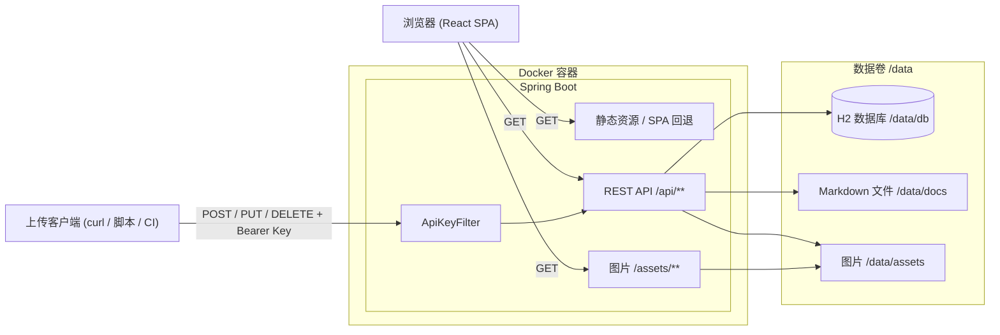
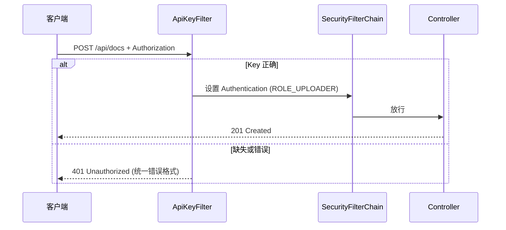

# DailyMark 设计文档

> 版本：v1.0　｜　日期：2026-10-14　｜　状态：草案

## 1. 概述与目标

DailyMark 是一个轻量的 Markdown 文档展示站点：通过带鉴权的 API 上传 Markdown 文件，任何人都可以在网页上浏览。

### 1.1 功能列表

| 编号 | 功能 | 说明 |
| --- | --- | --- |
| F1 | Markdown 展示 | 支持 GFM（表格、任务列表、删除线）、代码高亮、KaTeX 数学公式、文内目录（TOC） |
| F2 | 侧边栏列表 | 左侧边栏按上传时间倒序列出所有文档，按日期分组 |
| F3 | 默认页 | 访问首页 `/` 时显示最新上传的文档 |
| F4 | 上传文档 | 通过 API 上传 `.md` 文件，需 API Key 鉴权 |
| F5 | 覆盖 / 删除 | 覆盖同名文档、替换内容、删除文档，需鉴权 |
| F6 | 图片上传 | 上传 Markdown 中引用的图片，需鉴权；图片公开访问 |
| F7 | 搜索 | 按标题 / 正文关键字搜索 |
| F8 | 公开浏览 | 浏览无需登录，只有写操作需要鉴权 |

### 1.2 非目标

- 不做多用户账号体系、注册登录、权限分级
- 不做在线编辑器（内容只能通过 API 上传）
- 不做评论、统计等社交功能
- 不考虑大规模数据（目标量级：数千篇文档以内）

## 2. 架构

### 2.1 总体架构

单个 Spring Boot 进程同时提供 React 静态资源和 REST API，数据全部落在挂载卷 `/data` 中。



### 2.2 技术栈

**前端**

| 用途 | 选型 |
| --- | --- |
| 框架 / 构建 | React 18 + Vite + TypeScript |
| 路由 | React Router v6 |
| Markdown 渲染 | `react-markdown` + `remark-gfm` + `remark-math` |
| 后处理 | `rehype-sanitize`（XSS 过滤）、`rehype-katex`（公式）、`rehype-highlight`（代码高亮）、`rehype-slug`（标题锚点） |
| 样式 | `github-markdown-css` + 少量自定义 CSS |

**后端**

| 用途 | 选型 |
| --- | --- |
| 运行时 | Java 17，Spring Boot 3.x |
| Web | Spring Web（MVC） |
| 持久化 | Spring Data JPA + H2（文件模式） |
| 安全 | Spring Security + 自定义 `ApiKeyFilter` |
| 运维 | Spring Boot Actuator（健康检查） |
| 构建 | Maven |

## 3. 数据模型

Markdown 原文以文件形式存在 `/data/docs`，元数据存在 H2。正文同时在数据库存一份 `content`，供搜索使用（文件为权威来源，数据库副本在每次写入时同步更新）。

### 3.1 `document` 表

| 字段 | 类型 | 说明 |
| --- | --- | --- |
| `id` | UUID (PK) | 文档 ID，用于 URL `/doc/{id}` |
| `slug` | VARCHAR(255) | 由文件名生成（去扩展名、小写、非法字符替换为 `-`），仅用于展示和可读链接 |
| `title` | VARCHAR(255) | 取正文第一个 `# ` 一级标题；没有则用文件名（去扩展名） |
| `filename` | VARCHAR(255) UNIQUE | 上传时的原始文件名，用于判断是否同名覆盖 |
| `storage_path` | VARCHAR(512) | 相对 `/data/docs` 的存储路径，格式为 `{id}.md` |
| `size` | BIGINT | 字节数 |
| `content` | CLOB | 正文副本，用于搜索 |
| `uploaded_at` | TIMESTAMP | 首次上传时间（服务器时间），**排序依据**，覆盖时不变 |
| `updated_at` | TIMESTAMP | 最后修改时间 |

索引：`idx_document_uploaded_at (uploaded_at DESC)`、`uk_document_filename (filename)`。

### 3.2 `asset` 表

| 字段 | 类型 | 说明 |
| --- | --- | --- |
| `id` | UUID (PK) | 图片 ID |
| `filename` | VARCHAR(255) UNIQUE | 存储文件名，格式为 `{id}.{ext}`，避免重名和路径注入 |
| `original_name` | VARCHAR(255) | 上传时的原始文件名 |
| `storage_path` | VARCHAR(512) | 相对 `/data/assets` 的路径 |
| `content_type` | VARCHAR(100) | MIME 类型 |
| `size` | BIGINT | 字节数 |
| `uploaded_at` | TIMESTAMP | 上传时间 |

### 3.3 磁盘布局

```text
/data
├── db/            # H2 数据库文件 dailymark.mv.db
├── docs/          # {id}.md
└── assets/        # {id}.png / .jpg / ...
```

## 4. API 设计

统一前缀 `/api`，JSON 使用 camelCase，时间使用 ISO-8601（带时区，例如 `2026-10-14T21:00:00+09:00`）。

### 4.1 接口一览

| 方法 | 路径 | 鉴权 | 说明 |
| --- | --- | --- | --- |
| GET | `/api/docs?q=` | 否 | 文档列表，按 `uploadedAt` 倒序；`q` 可选，按标题 / 正文搜索 |
| GET | `/api/docs/latest` | 否 | 最新文档（元数据 + 正文）；无文档时返回 404 |
| GET | `/api/docs/{id}` | 否 | 指定文档（元数据 + 正文） |
| POST | `/api/docs` | 是 | 上传文档（multipart，字段 `file`），可选 `?overwrite=true` |
| PUT | `/api/docs/{id}` | 是 | 替换指定文档内容（multipart，字段 `file`） |
| DELETE | `/api/docs/{id}` | 是 | 删除文档 |
| POST | `/api/assets` | 是 | 上传图片（multipart，字段 `file`） |
| DELETE | `/api/assets/{id}` | 是 | 删除图片 |
| GET | `/assets/{filename}` | 否 | 图片静态访问 |
| GET | `/actuator/health` | 否 | 健康检查 |

### 4.2 数据结构

**列表项 `DocSummary`**（`GET /api/docs`，列表不返回正文）

```json
{
  "id": "3f1c...",
  "slug": "2026-10-14-daily",
  "title": "10 月 14 日日报",
  "filename": "2026-10-14-daily.md",
  "size": 2048,
  "uploadedAt": "2026-10-14T21:00:00+09:00",
  "updatedAt": "2026-10-14T21:00:00+09:00"
}
```

列表接口返回 `DocSummary[]`。数据量小，第一版不分页；后续可加 `page` / `size` 参数。

**详情 `DocDetail`**（`GET /api/docs/latest`、`GET /api/docs/{id}`）：在 `DocSummary` 的基础上增加 `"content": "# 10 月 14 日日报\n..."`。

**图片上传响应**

```json
{ "id": "a9e2...", "url": "/assets/a9e2....png", "originalName": "chart.png", "size": 102400 }
```

### 4.3 上传 / 覆盖规则

- `POST /api/docs`：
  - `filename` 不存在：新建，`uploadedAt = updatedAt = now`，返回 `201 Created` + `DocSummary`
  - `filename` 已存在且未带 `overwrite=true`：返回 `409 Conflict`
  - `filename` 已存在且 `overwrite=true`：覆盖内容，**保留原 `id` 和 `uploadedAt`**，刷新 `updatedAt`、`title`、`size`，返回 `200 OK`
- `PUT /api/docs/{id}`：替换内容，规则同覆盖；文件名不变
- 写入顺序：先写临时文件 `{id}.md.tmp`，再原子重命名为 `{id}.md`，最后在事务中更新数据库，防止半写文件
- `DELETE /api/docs/{id}`：删除数据库记录和磁盘文件，返回 `204 No Content`

### 4.4 校验与限制

| 项 | 限制 |
| --- | --- |
| 文档 | 扩展名 `.md` / `.markdown`；大小 ≤ 5 MB；必须是合法 UTF-8 |
| 图片 | 扩展名 `png` / `jpg` / `jpeg` / `gif` / `webp` / `svg`；大小 ≤ 10 MB；校验 MIME 与扩展名一致 |
| 文件名 | 长度 ≤ 255；去掉路径部分（防 `../` 穿越） |

`svg` 访问时加 `Content-Security-Policy: script-src 'none'` 响应头，防止内嵌脚本执行。

`spring.servlet.multipart.max-file-size=10MB`，文档的 5 MB 限制在业务层校验。

### 4.5 统一错误格式

```json
{
  "status": 409,
  "error": "CONFLICT",
  "message": "Document with filename '2026-10-14-daily.md' already exists",
  "path": "/api/docs",
  "timestamp": "2026-10-14T21:00:00+09:00"
}
```

由 `@RestControllerAdvice` 统一处理。常用状态码：`400` 参数 / 校验错误，`401` 未鉴权，`404` 不存在，`409` 同名冲突，`413` 文件过大。

## 5. 鉴权设计

### 5.1 方案

- 使用单个固定 API Key，来自环境变量 `DAILYMARK_API_KEY`
- 客户端请求头：`Authorization: Bearer <key>`
- 只有写操作需要鉴权：`/api/**` 下的 `POST` / `PUT` / `DELETE`
- 所有 `GET` 请求、静态资源、`/assets/**`、`/actuator/health` 公开

### 5.2 实现要点



- `ApiKeyFilter extends OncePerRequestFilter`：解析 Bearer token，使用 `MessageDigest.isEqual` 做**常量时间比较**，防止时序攻击
- `SecurityFilterChain`：
  - `csrf` 关闭（无 Cookie 会话，纯 Token）
  - `sessionManagement` 设为 `STATELESS`
  - `GET` 全部 `permitAll`，`/api/**` 的 `POST` / `PUT` / `DELETE` 需要 `hasRole("UPLOADER")`
  - `authenticationEntryPoint` 返回统一格式的 401 JSON
- 启动校验：`DAILYMARK_API_KEY` 未设置或长度 < 32 时**启动失败**并打印明确的错误日志，避免误部署成无鉴权状态
- 生成 Key 的建议：`openssl rand -hex 32`
- 日志中不打印 Key；鉴权失败只记录来源 IP 和路径

## 6. 搜索

- 第一版：数据库 `LIKE` 查询，大小写不敏感

  ```sql
  SELECT ... FROM document
  WHERE LOWER(title) LIKE LOWER(:kw) OR LOWER(content) LIKE LOWER(:kw)
  ORDER BY uploaded_at DESC
  ```

  其中 `:kw = '%' + 转义后的关键词 + '%'`（转义 `%`、`_`、`\`）
- 结果仍按 `uploadedAt` 倒序，返回 `DocSummary[]`
- 前端输入防抖 300 ms 后请求 `GET /api/docs?q=...`
- 适用量级：数千篇文档以内响应在毫秒级
- 升级路径：H2 内置全文索引（`FT_INIT` / `FT_SEARCH`），或引入 Lucene；返回结果可增加命中片段高亮

## 7. 前端设计

### 7.1 页面布局

```text
┌──────────────┬────────────────────────────────────┬───────────┐
│ DailyMark    │                                    │ 目录 TOC  │
│ [搜索框    ] │   # 10 月 14 日日报                │ - 标题一  │
│              │                                    │   - 小节  │
│ 2026-10-14   │   正文 ...                         │ - 标题二  │
│  · 日报      │                                    │           │
│  · 笔记 A    │   ```java                          │           │
│ 2026-10-13   │   代码高亮                         │           │
│  · 日报      │   ```                              │           │
│ ...          │                                    │           │
└──────────────┴────────────────────────────────────┴───────────┘
   左侧边栏                 主内容区                   右侧目录
```

- **左侧边栏**：顶部站点名 + 搜索框；下方是文档列表，按 `uploadedAt` 本地日期（`YYYY-MM-DD`）分组，组内按时间倒序；当前文档高亮
- **主内容区**：标题、上传 / 更新时间、Markdown 正文
- **右侧目录**：从正文 `h1`–`h3` 提取，点击滚动到锚点，滚动时高亮当前章节
- **响应式**：宽度 < 768 px 时左侧边栏收起为抽屉（汉堡按钮），右侧目录隐藏

### 7.2 路由

| 路由 | 行为 |
| --- | --- |
| `/` | 请求 `/api/docs/latest` 显示最新文档；无文档时显示空状态提示 |
| `/doc/:id` | 请求 `/api/docs/{id}`；404 时显示"文档不存在" |
| 其他 | 显示 404 页面 |

后端 SPA 回退：`SpaForwardController` 把不以 `/api`、`/assets`、`/actuator` 开头且不含 `.` 的路径 `forward:/index.html`，保证刷新 `/doc/xxx` 不会 404。

### 7.3 组件结构

```text
App
├── Layout
│   ├── Sidebar
│   │   ├── SearchBox
│   │   └── DocList (按日期分组)
│   ├── DocView
│   │   ├── DocHeader (标题 / 时间)
│   │   └── MarkdownRenderer
│   └── Toc
└── NotFound
```

- 数据获取：原生 `fetch` 封装在 `api.ts`；列表数据在 `Layout` 中加载一次，上传后刷新页面即可看到（第一版不做实时推送）
- 状态：加载中骨架屏、错误提示、空状态

### 7.4 Markdown 渲染

插件顺序：

```text
remark-gfm → remark-math → rehype-sanitize(自定义 schema) → rehype-katex → rehype-highlight → rehype-slug
```

- **XSS**：`rehype-sanitize` 放在 katex / highlight **之前**，只过滤用户原文；schema 在默认基础上允许 `className`（`language-*`、`math-*`）
- **图片路径改写**（`urlTransform`）：
  - `http(s)://`、`/` 开头：原样保留
  - 相对路径（如 `images/chart.png`、`./chart.png`）：改写为 `/assets/` + 文件名
  - 推荐用法：先调用 `POST /api/assets` 得到 `url`，在 Markdown 中直接写 ``
- **链接**：外部链接加 `target="_blank" rel="noopener noreferrer"`
- **样式**：`github-markdown-css` + `katex/dist/katex.min.css` + highlight.js 主题（`github`）

### 7.5 开发联调

Vite 开发服务器配置 `server.proxy`，把 `/api`、`/assets` 代理到 `http://localhost:8080`。

## 8. 目录结构

```text
DailyMark/
├── docs/
│   └── DESIGN.md
├── frontend/
│   ├── package.json
│   ├── vite.config.ts
│   ├── index.html
│   └── src/
│       ├── main.tsx
│       ├── App.tsx
│       ├── api.ts
│       ├── components/   # Layout, Sidebar, DocList, SearchBox, DocView, MarkdownRenderer, Toc
│       └── styles/
├── backend/
│   ├── pom.xml
│   └── src/main/
│       ├── java/com/dailymark/
│       │   ├── DailyMarkApplication.java
│       │   ├── config/       # SecurityConfig, ApiKeyFilter, StorageProperties, WebConfig
│       │   ├── controller/   # DocumentController, AssetController, SpaForwardController
│       │   ├── service/      # DocumentService, AssetService, StorageService
│       │   ├── repository/   # DocumentRepository, AssetRepository
│       │   ├── entity/       # Document, Asset
│       │   ├── dto/          # DocSummary, DocDetail, AssetResponse, ErrorResponse
│       │   └── exception/    # GlobalExceptionHandler, 业务异常
│       └── resources/
│           └── application.yml
├── Dockerfile
├── docker-compose.yml
├── .dockerignore
└── .gitignore
```

## 9. 部署

### 9.1 配置项

| 环境变量 | 默认值 | 说明 |
| --- | --- | --- |
| `DAILYMARK_API_KEY` | 无（必填） | 上传 API Key，长度 ≥ 32 |
| `DAILYMARK_DATA_DIR` | `/data` | 数据根目录 |
| `SERVER_PORT` | `8080` | 服务端口 |
| `TZ` | `Asia/Tokyo` | 容器时区，影响侧边栏日期分组的服务端时间 |
| `JAVA_OPTS` | `-Xms128m -Xmx512m` | JVM 参数 |

`application.yml` 关键配置：

```yaml
dailymark:
  api-key: ${DAILYMARK_API_KEY:}
  data-dir: ${DAILYMARK_DATA_DIR:/data}
spring:
  datasource:
    url: jdbc:h2:file:${dailymark.data-dir}/db/dailymark;AUTO_SERVER=FALSE
    username: sa
    password: ""
  jpa:
    hibernate:
      ddl-auto: update
    open-in-view: false
  h2:
    console:
      enabled: false
  servlet:
    multipart:
      max-file-size: 10MB
      max-request-size: 11MB
management:
  endpoints:
    web:
      exposure:
        include: health
```

> `ddl-auto: update` 适合第一版；表结构稳定后可改为 Flyway 管理迁移。

### 9.2 Dockerfile（多阶段构建）

```dockerfile
# ---------- 1. 构建前端 ----------
FROM node:20-alpine AS frontend
WORKDIR /app/frontend
COPY frontend/package*.json ./
RUN npm ci
COPY frontend/ ./
RUN npm run build

# ---------- 2. 构建后端 ----------
FROM maven:3.9-eclipse-temurin-17 AS backend
WORKDIR /app/backend
COPY backend/pom.xml ./
RUN mvn -q dependency:go-offline
COPY backend/src ./src
COPY --from=frontend /app/frontend/dist ./src/main/resources/static
RUN mvn -q package -DskipTests

# ---------- 3. 运行 ----------
FROM eclipse-temurin:17-jre
WORKDIR /app
RUN useradd -r -u 1001 dailymark && mkdir -p /data && chown dailymark /data
COPY --from=backend /app/backend/target/*.jar app.jar
USER dailymark
VOLUME ["/data"]
EXPOSE 8080
ENV JAVA_OPTS="-Xms128m -Xmx512m"
HEALTHCHECK --interval=30s --timeout=5s --retries=3 \
  CMD wget -qO- http://localhost:8080/actuator/health || exit 1
ENTRYPOINT ["sh", "-c", "exec java $JAVA_OPTS -jar app.jar"]
```

> `eclipse-temurin:17-jre` 镜像自带的是 `curl` 还是 `wget` 需要在实现时确认，健康检查命令按实际可用工具调整。

### 9.3 docker-compose.yml

```yaml
services:
  dailymark:
    build: .
    image: dailymark:latest
    container_name: dailymark
    restart: unless-stopped
    ports:
      - "8080:8080"
    environment:
      DAILYMARK_API_KEY: ${DAILYMARK_API_KEY:?DAILYMARK_API_KEY is required}
      TZ: Asia/Tokyo
    volumes:
      - ./data:/data
```

API Key 放在同目录的 `.env` 文件中（已加入 `.gitignore`）：

```text
DAILYMARK_API_KEY=<openssl rand -hex 32 生成的值>
```

启动：

```bash
docker compose up -d --build
```

> **重要：数据目录权限。** 容器以 UID `1001`（用户 `dailymark`）运行。宿主机的 `./data` 目录必须归 UID `1001` 所有并且可写，否则后端无法创建或写入 `/data/db`、`/data/docs` 和 `/data/assets`，容器会启动失败。首次部署或恢复数据时执行：
>
> ```bash
> mkdir -p data
> sudo chown -R 1001:1001 data
> ```
>
> 如果 `data` 目录由其他用户或 `root` 创建，必须重新执行上述授权命令；仅创建目录但未授权给 UID `1001` 不足以完成部署。

### 9.4 使用示例

```bash
KEY=<your-api-key>
HOST=http://localhost:8080

# 上传文档
curl -X POST "$HOST/api/docs" -H "Authorization: Bearer $KEY" -F "file=@2026-10-14-daily.md"

# 覆盖同名文档
curl -X POST "$HOST/api/docs?overwrite=true" -H "Authorization: Bearer $KEY" -F "file=@2026-10-14-daily.md"

# 上传图片，返回的 url 用于 Markdown 引用
curl -X POST "$HOST/api/assets" -H "Authorization: Bearer $KEY" -F "file=@chart.png"

# 删除文档
curl -X DELETE "$HOST/api/docs/<id>" -H "Authorization: Bearer $KEY"

# 列表 / 搜索（公开）
curl "$HOST/api/docs?q=日报"
```

## 10. 安全与运维

- **HTTPS**：容器只提供 HTTP，生产环境应放在 Nginx / Caddy / Traefik 等反向代理之后终止 TLS；API Key 只能通过 HTTPS 传输
- **备份**：所有状态都在 `/data`，备份该目录即可（建议在低峰期停写或使用 H2 的 `BACKUP TO` 命令保证数据库一致性）
- **恢复**：把备份的 `data` 目录放回并重启容器
- **日志**：输出到 stdout，由 Docker 收集（`docker logs`）；记录上传 / 删除操作（文件名、ID、来源 IP），不记录 Key
- **健康检查**：`/actuator/health`，仅暴露 health 端点
- **安全响应头**：`X-Content-Type-Options: nosniff`、`X-Frame-Options: DENY`（Spring Security 默认开启）
- **限流（可选）**：写接口量很小，第一版不做；如需要可在反向代理层配置
- **Key 轮换**：修改 `.env` 中的值后 `docker compose up -d` 重启生效

## 11. 后续扩展

- 多个 API Key（按客户端区分、可单独吊销），或接入 OAuth / 登录页实现网页上传
- 标签 / 分类，侧边栏按分类筛选
- 解析 Markdown front matter（`title`、`date`、`tags`），支持自定义展示日期
- 全文索引与命中片段高亮
- 列表分页 / 虚拟滚动
- RSS 订阅
- 图片引用检查：删除文档时清理不再被引用的图片
